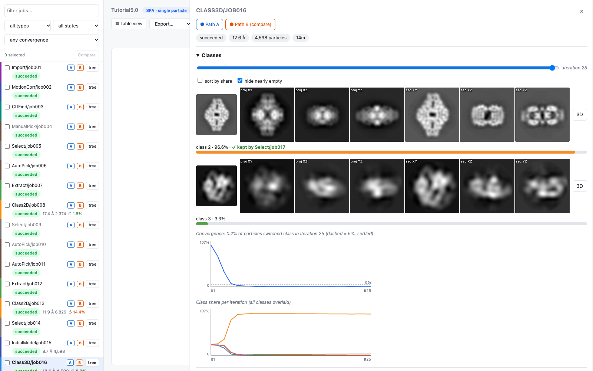
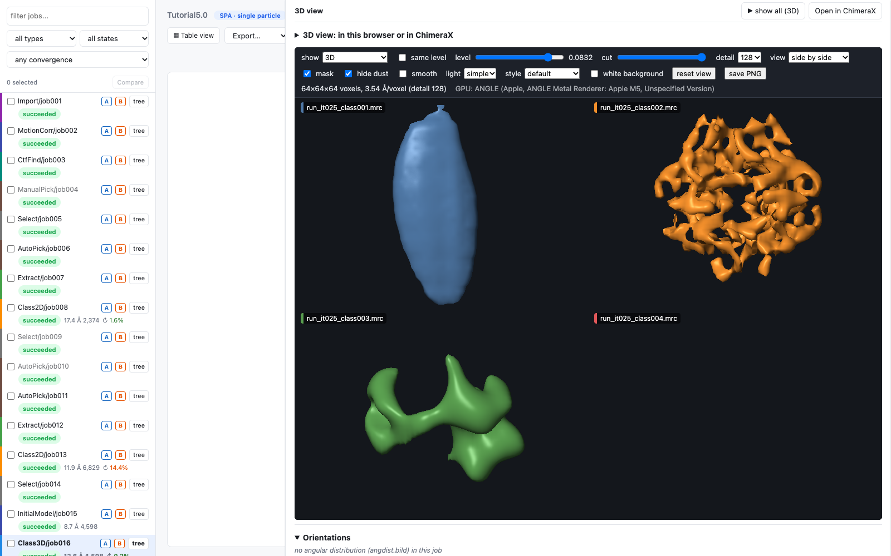

# ChimeraX and 3D

## The built-in viewer comes first

Open a job's Details drawer in `reliontree watch`: below the 2D classes sits a 3D view of the job's maps, drawn in the
browser (WebGL2, nothing to install, no new tab). A classification shows all its classes side by side, each in the
colour of its class card, with a shared rotation; a refinement shows its main map. **Open in ChimeraX** stays one click
away in the viewer header.



Each class card shows the map's mean projections (top) and central sections (bottom) along XY, XZ and YZ next to the 2D
thumbnail; click them to open the sections in the viewer, with a slider per axis. Classes can be sorted by share and
nearly empty ones hidden.



In the viewer: **show** 3D, central sections or mean projections; **level** (each map starts at its own level so none
is empty; "same level" uses one real-unit level for all); **cut**; **hide dust** (drops small floating blobs);
**smooth**; **light** simple/soft; **style** default/paper/clay/depth; white background; PNG export. Compare two maps as
a difference (orange/blue), show a mask as a see-through shell, or colour a map by local resolution.
`reliontree render` writes the same views as PNG files (and turntables) through headless Chrome, for papers and
reports; results are cached under `.reliontree/renders/`.

*Screenshots: RELION 5 tutorial data (β-galactosidase, JEOL CRYO ARM 200, recorded by T. Kato, N. Terahara and K. Namba,
Osaka University; full data set [EMPIAR-10204](https://www.ebi.ac.uk/empiar/EMPIAR-10204/), DOI
[10.6019/EMPIAR-10204](https://doi.org/10.6019/EMPIAR-10204), CC0) processed with
[RELION](https://relion.readthedocs.io) following its
[tutorial](https://relion.readthedocs.io/en/latest/SPA_tutorial/Introduction.html); only the precalculated results are shown.
If you use RELION, please cite it as described on its website, e.g. Scheres SHW, *J. Struct. Biol.* 180, 519 (2012).*


Every job card that holds a map has a blue **3D** chip (and a violet **Mask** chip). The Details drawer lists everything
a job holds: post-processed map, final map, all classes, half maps, masks and angular-distribution `.bild` files.

## What you need

- **ChimeraX** (any recent version) on the machine that shows the maps. On a cluster this is usually `module load chimerax`
  (see *Settings* below).
- **InstantMap is optional.** reliontree starts ChimeraX with its own listener, so the 3D buttons work in a plain ChimeraX.
  [ChimeraX-InstantMap](https://github.com/LUKASinScience/ChimeraX-InstantMap) adds `instantmap listen` for a window you
  already have open, and masks and RELION tools of its own.

## One window, no open port

A click hands the map to **one** ChimeraX window. reliontree never opens a network port towards ChimeraX (ChimeraX's own
REST interface has no token, so any web page could drive it). Instead it writes a small request file into a private
directory (`~/.reliontree/chimerax`, mode 0700); a listener inside ChimeraX picks it up and runs only `open <map>`
(plus `tile` and an optional FigureStyle template). Requests must come from your own user, be younger than five minutes
and name existing `.mrc`/`.map`/`.bild` files.

If no ChimeraX with the listener runs, the first click starts one with reliontree's own listener; every later click
goes to that window. You do not need InstantMap for this. For a ChimeraX you already have open:

```
runscript /path/printed/by/reliontree-listener-path
```

(or `instantmap listen` with ChimeraX-InstantMap).

## Settings (clusters and modules)

The gear icon opens the settings; the same from the shell:

```bash
reliontree settings                                   # show
reliontree settings --chimerax /opt/chimerax/bin/chimerax
reliontree settings --run-first "module load chimerax"
reliontree settings --check                           # runs the snippet and `ChimeraX --version`
```

*Run first* is a shell snippet executed before ChimeraX is started (typically `module load ...`). Both fields are run by
the shell on the machine where reliontree runs, which is why the web page can only change them with a per-run token and
from its own origin. On a cluster ChimeraX needs a display (for example `ssh -X`).

## From the shell

```bash
reliontree maps --job Refine3D/job042                     # what is there
reliontree open --job Refine3D/job042                     # most important map
reliontree open --job Refine3D/job042 --map mask          # pick by label
reliontree open --job Class3D/job010 --no-tile            # several maps, not side by side
```

## Figure styles

With the [FigureStyle](https://github.com/LUKASinScience/ChimeraX-FigureStyle) bundle installed, reliontree can apply a
style template to what it opens: set *FigureStyle template* in the settings (or `--template` on `open`). The first map of
a click becomes the template's map, the second its second map (mask, half map), for example *Mask overlay* or
*Half-map comparison*. Without FigureStyle, or with a misspelt name, the maps still open and ChimeraX logs a warning.
Thresholds in the templates are starting points: set the level per map and state it in the figure legend.
