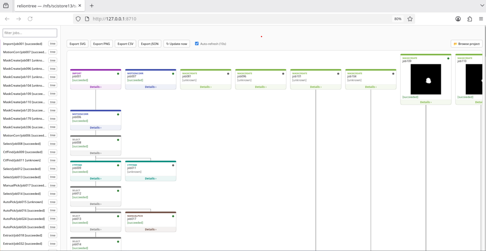
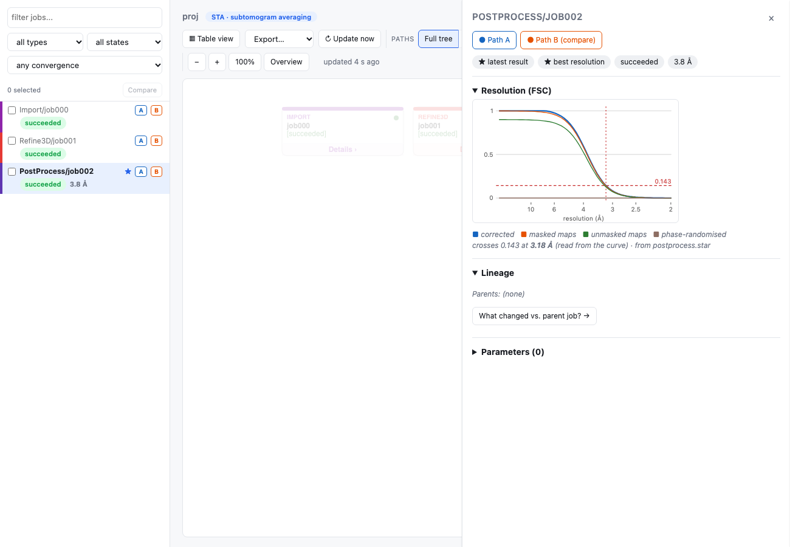

---
hide:
  - toc
---

<div class="rt-hero" markdown>

# reliontree

**One job, one cheese, one relentless mouse. The map of the hunt through your RELION project.**

{ .rt-hero-gif }

[Install :material-download:](#install){ .md-button .md-button--primary }
[Command reference](commands.md){ .md-button }
[GitHub](https://github.com/LUKASinScience/reliontree){ .md-button }

</div>

A standalone viewer for the job lineage of a RELION project: no ChimeraX, no third-party server framework and no GUI toolkit
needed. The default path is a self-starting, standard-library local server, with the same single command on a workstation,
an HPC login node (no X11, no root) or a cloud VM.

## What you get

<div class="grid cards" markdown>

-   :material-graph-outline: **See every job**

    ---

    The whole lineage as a tree: state, resolution, particle count, masks, the path to the latest and best result.

    [Command reference](commands.md)

-   :material-compare-horizontal: **Compare runs**

    ---

    Changed options, resolution and particles side by side, and how particles moved between two classifications.

    [Comparing jobs](compare.md)

-   :material-cube-outline: **Open maps in ChimeraX**

    ---

    One click opens a job's maps or masks in a single ChimeraX window, with an optional FigureStyle template.

    [ChimeraX and 3D](chimerax.md)

-   :material-chart-bell-curve: **FSC and orientations**

    ---

    Resolution curves and angular distributions in the job details, straight from RELION's own files.

    [See it below](#see-it)

-   :material-robot-outline: **Scripts and AI assistants**

    ---

    JSON output everywhere and a read-only MCP server, so an assistant can answer "which job made this map?".

    [Scripts and AI](ai.md)

-   :material-server: **Cluster ready**

    ---

    Plain Python, no dependencies: a venv, a module file or its own batch job.

    [Install](#install)

</div>

## Install

reliontree needs **Python 3.9 or newer** and nothing else. It is not on PyPI yet, so it installs from GitHub. Click the way
that fits your machine:

??? install "Environment: venv or conda (recommended for daily use)"

    ```bash
    python3 -m venv ~/venvs/reliontree
    source ~/venvs/reliontree/bin/activate
    pip install "git+https://github.com/LUKASinScience/reliontree"
    reliontree --help
    ```

    With conda: `conda create -n reliontree python=3.12 pip`, `conda activate reliontree`, then the same `pip install`.
    In an environment you already have, run only the `pip install` line. Update later with
    `pip install --upgrade "git+https://github.com/LUKASinScience/reliontree"`.

??? install "Module on a cluster: module load reliontree"

    For clusters that provide software through Lmod or Environment Modules. An admin sets it up once with the files in
    [`contrib/modules/`](https://github.com/LUKASinScience/reliontree/tree/main/contrib/modules):

    ```bash
    ./install.sh /shared/apps/reliontree/<version>     # a private venv in a shared place
    cp -r reliontree /shared/modulefiles/              # modulefiles, with install_dir edited to that path
    ```

    Users then run `module load reliontree` and use exactly the same `reliontree` command and options; the module only puts
    the venv's `bin/` on `PATH`. To run the viewer as its own batch job instead of on a login node, see
    [`contrib/slurm/`](https://github.com/LUKASinScience/reliontree/tree/main/contrib/slurm).

??? install "Try it without installing anything"

    ```bash
    uvx --from git+https://github.com/LUKASinScience/reliontree reliontree
    ```

    No `uv`? `pipx run --spec git+https://github.com/LUKASinScience/reliontree reliontree` does the same. Both run reliontree
    in an isolated environment and leave nothing behind.

!!! info "For the 3D buttons"

    You also need [ChimeraX](https://www.cgl.ucsf.edu/chimerax/) on the machine that shows the maps. The plugin
    [ChimeraX-InstantMap](https://github.com/LUKASinScience/ChimeraX-InstantMap) is **optional**: reliontree starts ChimeraX
    with its own small listener, so the buttons work without it. InstantMap adds `instantmap listen` for a window you already
    have open, plus its mask and RELION tools. Details: [ChimeraX and 3D](chimerax.md).

## First run

```bash
reliontree
reliontree /path/to/project    # same, pointed at an explicit directory
```

Run from inside (or under) a RELION project directory. With no arguments,
reliontree walks upward looking for `default_pipeline.star` — the same way
`git status` finds its repository — and opens a live local view in your
browser: job cards with map/mask thumbnails, a click-to-browse sidebar, and
an in-page directory picker to switch projects. If no project is found at
all, it still starts and lets you browse to one instead of exiting with an
error.




## See it

=== "Job tree"

    

=== "Live browsing"

    

=== "FSC curves"

    

    A PostProcess job shows its FSC curves (corrected, masked, unmasked, phase-randomised) from `postprocess.star`; a Refine3D
    job without post-processing shows the gold-standard curve from `run_model.star`. The marked 0.143 crossing is
    interpolated, so it can differ from the number RELION reports (a shell value) by up to one shell. Orientation globes also
    work for jobs without `*_angdist.bild`: they are then built from the angles in `run_data.star`.

## Where next

- [Command reference](commands.md): every subcommand, in detail
- [Comparing jobs](compare.md): `compare`, `diff`, `overlap`, `why`, in the browser and in the shell
- [ChimeraX and 3D](chimerax.md): the 3D buttons, settings for clusters, figure styles
- [Scripts and AI assistants](ai.md): JSON output, the MCP server, headless ChimeraX
- [Library and other tools](more.md): using reliontree from Python, and how it fits next to other RELION tools
- [FAQ](faq.md)

## Why "reliontree"

In relion, the mouse cursor hunts down exactly one piece of cheese per
job, chasing it all the way to the end. reliontree is about the whole job
tree: the mouse's full hunting journey across every job, in one run.


On a machine with no browser available (a cluster login node), use
`reliontree tree --format html -o tree.html` for the old single-file static
export instead — no server, just a file to `scp` back or open from a
mounted path.

## Origin

The pipeline-parsing and job-tree-diagram logic here started as the
Qt/ChimeraX-free core of the
[ChimeraX-InstantMap](https://github.com/LUKASinScience/ChimeraX-InstantMap)
plugin's RELION History tab — extracted into its own package since it never
needed ChimeraX to begin with. ChimeraX-InstantMap's homepage:
[github.com/LUKASinScience/ChimeraX-InstantMap](https://github.com/LUKASinScience/ChimeraX-InstantMap).

## Authors

- **Lukas W. Bauer** ([LUKASinScience](https://github.com/LUKASinScience)): author
- **Serhat Dönmez** ([serhatdonmez98-cmd](https://github.com/serhatdonmez98-cmd)): co-author; concept, screenshots and the demo GIF
- **Claude Code** (Anthropic): AI pair-programming assistant, wrote and reviewed a substantial part of this codebase alongside Lukas

## License

GNU Affero General Public License v3.0 (AGPL-3.0-or-later).
